# Ibadat Ali — AI Engineer & AI Agent Developer

I engineer AI agents and model-backed products, connecting models, tools, retrieval, APIs, evaluation, and clear human handoffs.

[Portfolio website](https://ibadat-ali-portfolio.vercel.app/) · [GitHub profile](https://github.com/Ibadat-Ali86) · [Email](mailto:ibadcodes@gmail.com)

My focus is AI engineering and agent development: tool-using workflows, MCP integrations, retrieval systems, and applied ML products. My experience includes an ML / AI Engineer role, a Data Scientist internship, and independent delivery. The portfolio distinguishes live products, client work, research prototypes, and the evidence available to inspect each project.

## Selected work

- **WhatsApp Transaction Verification AI Agent** — Private client workflow with bounded evidence extraction and payment reconciliation; see the [portfolio case study](https://ibadat-ali-portfolio.vercel.app/#featured), with no source repository exposed.
- **[CodeScope MCP Preflight](https://github.com/Ibadat-Ali86/codescope-mcp-preflight)** — Local-first repository context and retrieval for coding-agent workflows.
- **[AI-Powered WhatsApp Restaurant Chatbot](https://ibadat-ali-portfolio.vercel.app/#featured)** — Workflow connecting WhatsApp conversations, FAQs, orders, and inventory tools.
- **[CareVision](https://github.com/Ibadat-Ali86/carevision)** — Multimodal, human-reviewed prototype; not a diagnostic system.
- **[SentinelIQ](https://github.com/Ibadat-Ali86/sentinel-iq-cmpass-nasa-rul-prediction)** — Predictive-maintenance system combining sequence models, anomaly signals, explanations, and planning.
- **[AdaptIQ / ForecastAI](https://github.com/Ibadat-Ali86/Demand-Sales-Walmart-Forecasting)** — Retail forecasting workflow with model comparison and a planning interface.
- **[TopoLite-KD](https://github.com/Ibadat-Ali86/TopoLite-KD-Efficient-Topology-Aware-Knowledge-Distillation-for-COVID-19-CT-Slice-Classification)** — Research prototype exploring topology-aware knowledge distillation.

Project claims are kept deliberately narrow: metrics are shown only when their definitions and results can be verified, and private client source code is not linked.

## WhatsApp Transaction Verification AI Agent — architecture

The public case study documents the delivery boundary without exposing the private client repository, credentials, webhook URLs, customer data, or payment records. Its n8n editor capture is available in the [portfolio case study](https://ibadat-ali-portfolio.vercel.app/#featured).

```mermaid
flowchart LR
  WA[Allowlisted WhatsApp<br/>payment screenshot] --> B[Baileys / Node.js intake]
  B --> Q[Fair work queue]
  Q --> W[WhatsApp webhook]
  W --> V[Validate event]
  V -->|Invalid| RI[Respond invalid event]
  V -->|Valid| I[Idempotency guard]
  I --> D{Duplicate message?}
  D -->|Yes| RD[Respond duplicate]
  D -->|No| O[FastAPI OCR service]
  O --> T[Tesseract OCR]
  T --> F{Evidence complete?}
  F -->|No, bounded fallback| GV[Groq Vision]
  F -->|Yes| N[Normalize OCR evidence]
  GV --> N
  N --> P[Prepare Stripe evidence]
  P --> G{Stripe verification enabled?}
  G -->|Yes| S[Stripe test verifier]
  G -->|No or ambiguous| MR[Manual review boundary]
  S --> FV[Format verified result]
  FV --> RV[Respond verified result]
  MR --> FO[Format OCR or review result]
  FO --> RO[Respond OCR result]
```



### How the workflow works

1. An allowlisted WhatsApp payment screenshot enters the Baileys / Node.js intake, where a fair queue preserves work ordering before workflow processing.
2. n8n receives the queued event through a webhook and validates it before any downstream work.
3. An idempotency guard and duplicate check prevent a repeated message from being reprocessed.
4. The OCR service extracts candidate fields with Tesseract and uses the bounded vision fallback only when the evidence is incomplete; normalized OCR remains an extraction input, not payment authority.
5. When the controlled Stripe test-verification branch is enabled, eligible evidence is sent to the verifier and formatted into a separate verification response. Otherwise—or when proof stays ambiguous—the result remains bounded for manual review.

The diagram reflects the supplied n8n editor capture and the public case-study documentation. It is an implementation overview, not a claim of current production availability, transaction volume, verification accuracy, or automated approval.

## About this repository

This repository contains the responsive, single-page portfolio website for Ibadat Ali. It presents AI agent workflows, applied AI engineering, project evidence, experience, and contact information.

## Architecture

- Semantic single-page HTML with build-time project rendering
- Vanilla JavaScript for navigation, filters, the portfolio assistant, restrained GSAP reveal motion, Lenis enhancement, and media fallbacks
- Modular CSS with controlled digital-brutalist tokens and responsive grids
- One canonical project source: `src/data/projects.js`
- A serverless `/api/chat` route using `meta/llama-3.1-8b-instruct` through NVIDIA's hosted API

The build-time renderer writes the project catalog from a single source of truth in a priority-ordered layout. Projects are grouped for browsing and remain available before JavaScript loads.

## Portfolio experience

- Featured systems and selected case studies lead the catalog; focused labs follow them.
- Every project opens a case-study detail view with scope, approach, result, technology, and available evidence
- Client and workflow evidence is labeled explicitly, with private work protected from source links
- Responsive layouts support mobile, tablet, and desktop widths; keyboard and reduced-motion preferences are supported

Parent collections and duplicate/upstream repositories are intentionally excluded. The private-client card presents its required public live-site action only.

## Setup

```bash
nvm use
npm ci
npm run dev
```

Copy `.env.example` to `.env.local` and provide `NVIDIA_API_KEY` to enable the assistant locally. The key is server-only: never use a `VITE_` prefix and never commit the populated environment file.

## Quality commands

```bash
npm run lint
npm test
npm run build
npm run validate:html
npm run check
npm run test:e2e
npm run test:links
```

## Assets and privacy

- Generated abstract artwork lives in `public/assets/generated/`; provenance is documented there.
- The profile image is user-supplied and optimized locally; no generated likeness is used.
- The interview section is intentionally absent from the public page until a video, poster, and captions are supplied.
- The contact form uses a local `mailto:` fallback; no external form endpoint or analytics provider has been configured.

## Deployment

The production artifact is `dist/` after `npm run build`. The portfolio is deployed through the linked Vercel project at https://ibadat-ali-portfolio.vercel.app. Add `NVIDIA_API_KEY` to the Vercel project's Production, Preview, and Development environments before deployment.

The original handoff documents are retained unchanged in `docs/portfolio-handoff/`.
